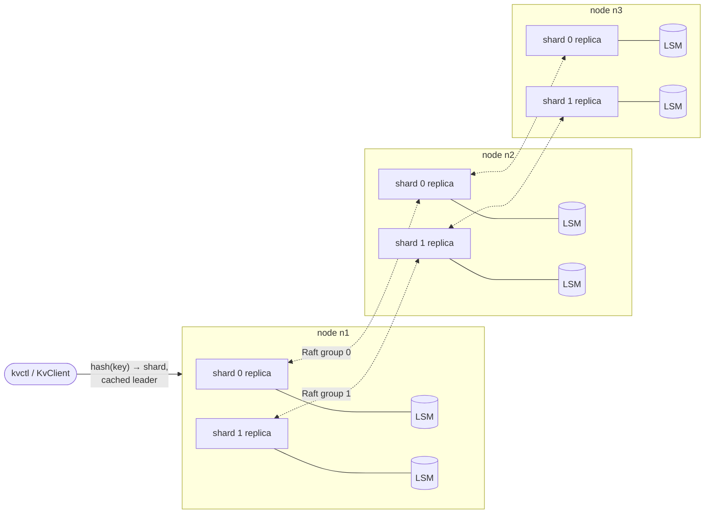

# Distributed Key-Value Store

[](https://github.com/pavanprudhvi02/distributed-kv-store/actions/workflows/ci.yml)

A sharded, replicated key-value store in C++20. Keys are spread over shards with consistent hashing, every shard is replicated across nodes with its own **Raft** group, and each replica stores its data in an **LSM-tree** engine written from scratch. Nodes talk to each other and to clients over **gRPC**.

Originally built for my Spring 2025 coursework at the University of Florida; this repository is a clean rebuild.

**Stack:** C++20, gRPC, Protocol Buffers, CMake, GoogleTest, Docker

## Architecture



- **Sharding.** `HashRing` puts 128 virtual points per shard on a 64-bit ring. A key belongs to the first point clockwise from its hash. Clients and servers use the same ring, so a client knows a key's shard without asking. Adding a shard moves only about 1/N of the keys, and only onto the new shard.
- **Replication.** Every node hosts one replica of every shard, and each shard is its own Raft group, so different shards can have leaders on different nodes. Writes go to the shard's leader; a node that isn't the leader answers `NOT_LEADER` with the leader's address, and the client follows it and caches it.
- **Storage.** Each replica's state machine is an LSM tree on local disk.

## Raft (`src/raft`)

| Part | What it does |
|---|---|
| Leader election | Randomized timeouts; votes go only to candidates whose log is at least as up to date |
| Log replication | One in-flight AppendEntries per follower, pipelined up to 256 entries; on a mismatch the follower returns the first index of the conflicting term, so the leader skips a whole term at a time |
| Commit rule | The leader only counts replicas for entries from its own term, and writes a no-op when elected (Raft §5.4.2) |
| Durability | Term, vote and log are on disk (CRC-checked records, fsync) before the node answers an RPC that depends on them |
| Linearizable reads | ReadIndex: the leader records its commit index, confirms it is still leader with a heartbeat round to a majority, waits for apply to catch up, then reads. An isolated leader that still thinks it leads cannot serve a stale read. |
| Transport | `Transport` interface with a gRPC implementation for real clusters and a simulated network for tests |

Not implemented yet: snapshots and log compaction (the log grows and is replayed from the start on restart), membership changes, and pre-vote.

## LSM-tree engine (`src/storage`)

```
put/delete ─► WAL (CRC per record, fsync optional) ─► active memtable (sorted map)
                                                          │ full
                                                          ▼
                                       immutable memtable ─► background flush ─► SSTable (newest)
                                                                                     │ too many
                                                                                     ▼
                                                    k-way merge compaction ─► one SSTable, tombstones dropped
get ─► active memtable ─► immutable memtable ─► SSTables newest → oldest (bloom filter first)
```

- **SSTable format:** sorted records, a sparse index (every 16th key), a bloom filter (10 bits per key) and a footer with a CRC over the whole file. A lookup checks the bloom filter, binary-searches the in-memory index and reads one index interval from disk.
- **Crash safety:** a `MANIFEST` file lists the live tables and is replaced atomically with rename. Tables and WALs that aren't referenced are cleaned up at startup, and the WAL replay stops at a torn or corrupt tail.
- **Concurrency:** readers take a snapshot of (memtable, immutable memtable, table list) under a short lock and read without blocking writers. A full memtable is swapped out and flushed on a background thread from the `ThreadPool`. A writer only waits if the previous flush hasn't finished yet (backpressure).

## Running a cluster

### Docker

```bash
docker compose up -d --build
docker compose exec n1 kvctl --cluster n1:7001,n2:7001,n3:7001 put user:1 ada
docker compose exec n1 kvctl --cluster n1:7001,n2:7001,n3:7001 get user:1
docker compose exec n1 kvctl --cluster n1:7001,n2:7001,n3:7001 status
docker compose stop n2      # writes keep working with 2 of 3 nodes
```

### From source

Requires CMake 3.20+, a C++20 compiler, gRPC and Protobuf (`apt install libgrpc++-dev libprotobuf-dev protobuf-compiler-grpc` on Ubuntu 24.04). GoogleTest is fetched by CMake.

```bash
cmake -S . -B build -DCMAKE_BUILD_TYPE=Release
cmake --build build -j

C=n1=127.0.0.1:7001,n2=127.0.0.1:7002,n3=127.0.0.1:7003
build/kvd --id n1 --listen 127.0.0.1:7001 --cluster $C --shards 4 --data data/n1 &
build/kvd --id n2 --listen 127.0.0.1:7002 --cluster $C --shards 4 --data data/n2 &
build/kvd --id n3 --listen 127.0.0.1:7003 --cluster $C --shards 4 --data data/n3 &

build/kvctl --cluster $C put greeting hello
build/kvctl --cluster $C get greeting
build/kvctl --cluster $C status          # role, term, leader, commit and applied index per shard
build/kvbench --cluster $C --threads 8 --ops 2000 --read-ratio 0.5
```

The core library (storage, Raft, sharding) has no gRPC dependency. Configure with `-DKV_BUILD_SERVER=OFF` to build and test it without gRPC installed.

## Tests

```bash
ctest --test-dir build --output-on-failure
scripts/cluster_test.sh build
```

| Suite | Covers |
|---|---|
| `storage_test`, `lsm_test` | WAL replay with torn and corrupted tails, SSTable lookups and corruption detection, bloom filter false-positive rate, 20k random operations checked against a reference `std::map` through flushes and compactions, recovery after restart, concurrent readers and writers |
| `raft_test` | One leader per term, identical apply order on every replica, follower redirects, leader crash with committed entries kept, full-cluster restart from disk, a follower catching up 600 entries, single-node groups, read-your-writes through ReadIndex |
| `raft_partition_test` | **Network partitions** on a simulated network: a leader cut off in a minority cannot commit and steps down on heal, with its uncommitted entry discarded; an isolated leader refuses reads; an isolated follower rejoins and repairs its log; six rounds of random majority/minority splits with 10% message loss, checking that replicas never diverge and **no acknowledged write is lost** |
| `hash_ring_test` | Determinism, balance within 20% across 8 shards, adding a shard moves about 1/5 of the keys and only onto the new shard |
| `shard_test` | 3 nodes × 4 shards with real LSM storage: keys spread across shards, all replicas hold the same data, and the cluster survives a node crash; the node catches up on restart |
| `cluster_test.sh` | Real `kvd` processes over gRPC: 300 writes, reads and deletes, kill a node, keep writing, restart it and check it caught up |

CI builds everything, runs the suites, runs the cluster test, runs the core tests again under AddressSanitizer + UBSan and under ThreadSanitizer, and smoke-tests the Docker Compose cluster.

## Layout

```
proto/kv.proto        client API and Raft RPCs
src/common/           Status, varint coding, CRC32, ThreadPool
src/storage/          WAL, memtable, SSTable, bloom filter, LSM tree
src/raft/             Raft node, durable log, log commands
src/shard/            consistent-hash ring, shard replica (Raft + LSM)
src/server/           gRPC transport, node service, kvd
src/client/           client library, kvctl, kvbench
tests/                GoogleTest suites and the simulated network
scripts/              multi-process cluster test
```

## What I would add next

- Raft snapshots with log truncation, so restarts don't replay the whole log
- Pre-vote, so a rejoining node with an inflated term doesn't force an election
- Leveled compaction in place of the single full merge
- Range scans

## License

MIT
